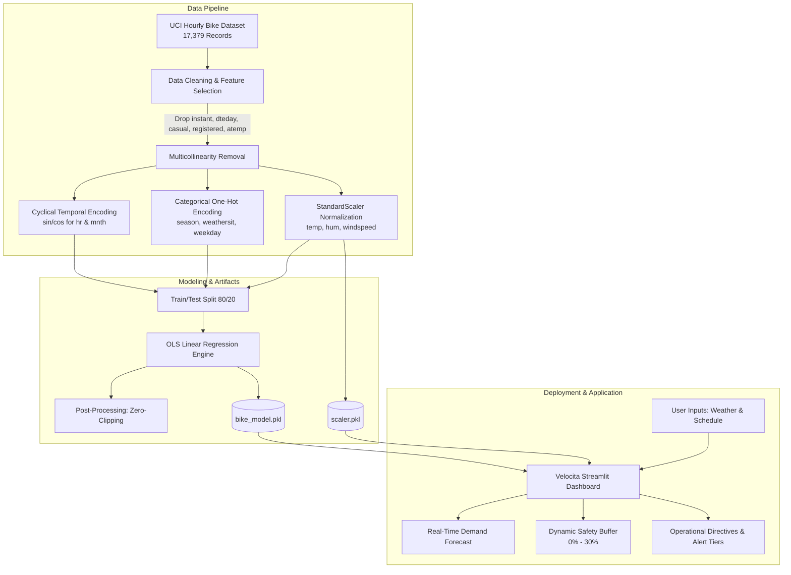
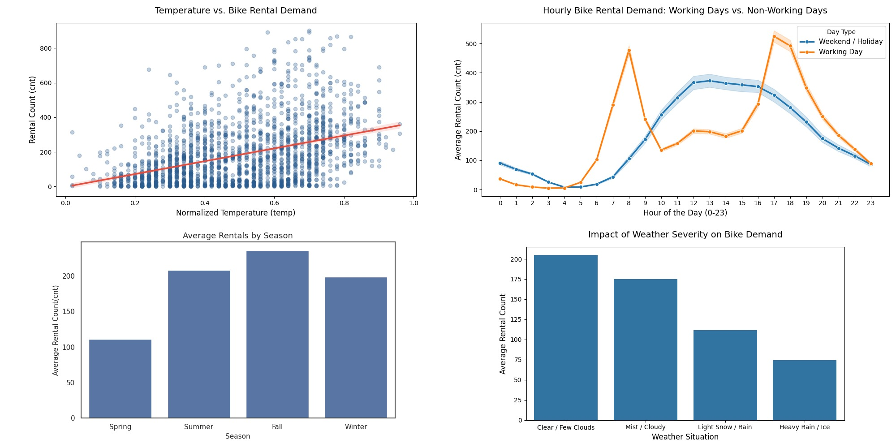
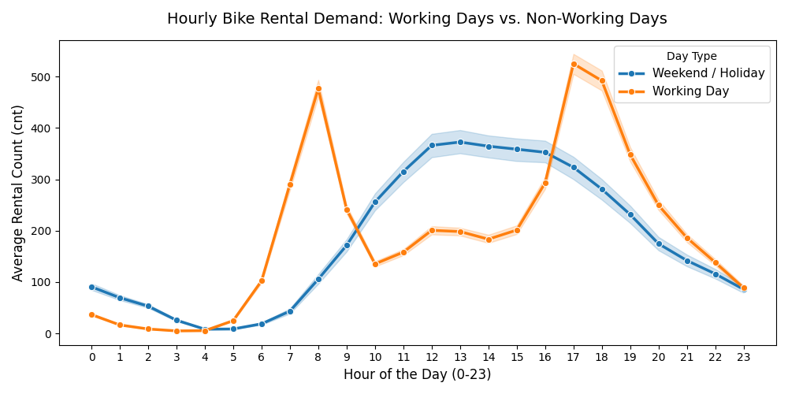
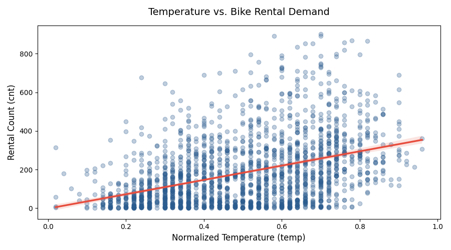
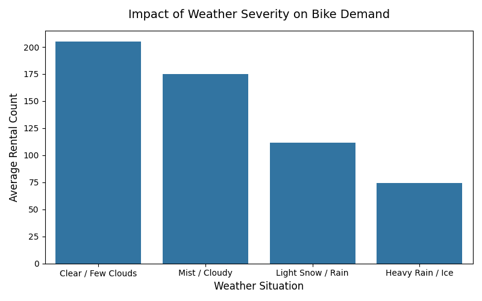
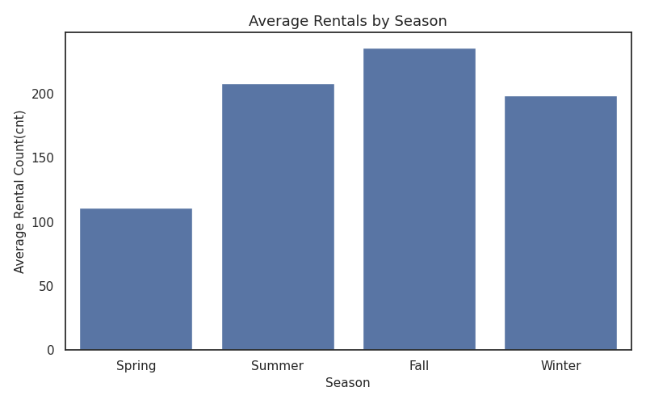
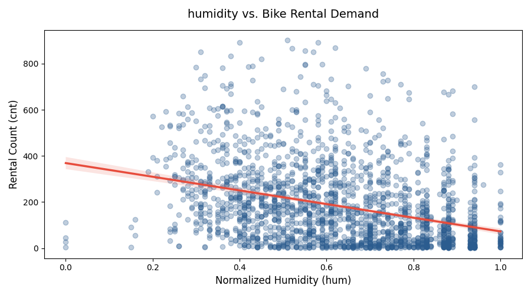
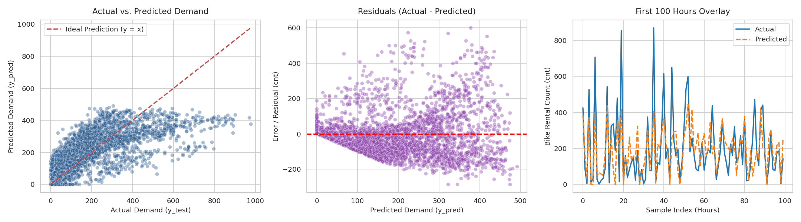

# 🚲 Velocita | Bike Rental Demand Forecaster

[](https://www.python.org/)
[](https://streamlit.io/)
[](https://scikit-learn.org/)
[](https://pandas.pydata.org/)
[](https://numpy.org/)
[](https://opensource.org/licenses/MIT)

An end-to-end Machine Learning pipeline and interactive decision-support system designed to forecast urban bike-sharing demand and empower operations teams with proactive fleet rebalancing recommendations.

---

## 📌 Executive Summary & Business Context

Urban bike-sharing systems (such as Citi Bike, Santander Cycles, and Lime) frequently face severe spatial and temporal inventory imbalances:

* **Morning & Evening Surges:** Heavy commuter influx empties docks in residential or commercial hubs, resulting in lost revenue and stranded riders.
* **Midday / Off-Peak Idleness:** Fleets accumulate in low-demand transit hubs without utilization.
* **Weather Sensitivity:** Rainfall, extreme temperatures, and severe humidity drastically alter rider behavior in minutes.

**Velocita Predictive Analytics** bridges the gap between historical telemetry and operational execution. By training an interpretable Machine Learning regression model on historical hourly records and deploying it via an intuitive Streamlit dashboard, fleet managers can anticipate surges, allocate safety buffer capacities, and schedule maintenance downtime with confidence.

---

## 📐 System Architecture & Workflow



---

## 📊 Exploratory Data Analysis & Key Insights

Comprehensive exploratory analysis was conducted across 17,379 hourly observations from the Capital Bikeshare system.



### 1. Commuter Dynamics: Working Days vs. Non-Working Days
* **Working Days:** Display prominent **bimodal demand spikes** corresponding directly with morning peak (**08:00 AM**, ~480 bikes/hr) and evening rush hour (**05:00 PM - 06:00 PM**, ~530 bikes/hr).
* **Weekends & Holidays:** Demand follows a unimodal, gentle bell curve peaking in the afternoon (**01:00 PM - 04:00 PM**, ~370 bikes/hr), reflecting recreational and casual riding.



### 2. Environmental & Weather Dynamics
* **Temperature:** Strong positive correlation with rental counts up to comfortable warm temperatures (22°C - 30°C). Demand tapers off during sub-zero cold or excessive heat.
* **Humidity & Wind:** High relative humidity (>75%) and gusty wind speeds significantly depress demand.
* **Weather Severity:** Clear skies average over **205 rentals/hr**, dropping to **175** in misty conditions, **112** in light rain/snow, and plunging to **74** during severe thunderstorms or icy precipitation.

| Environmental Metric | Impact on Rental Volume | Recommended Operational Posture |
|:---|:---|:---|
| **Clear / Few Clouds (Type 1)** | Peak adoption (~205 avg rentals/hr) | Full fleet deployment; active dock rebalancing |
| **Mist / Overcast (Type 2)** | Moderate adoption (~175 avg rentals/hr) | Standard fleet distribution |
| **Light Rain / Snow (Type 3)** | Low adoption (~112 avg rentals/hr) | Retract peripheral bikes; staging in covered hubs |
| **Heavy Storm / Ice (Type 4)** | Severe drop (~74 avg rentals/hr) | Minimal fleet; trigger scheduled maintenance |

<div align="center">
  
  
</div>

<div align="center">
  
  
</div>

---

## 🧠 Machine Learning Pipeline

### Data Preprocessing & Feature Engineering
1. **Multicollinearity Elimination:**
   * Dropped `atemp` due to severe collinearity ($r > 0.99$) with `temp`.
   * Dropped `casual` and `registered` sub-counts to avoid target leakage with `cnt = casual + registered`.
   * Dropped identifiers `instant` and `dteday`.
2. **Cyclical Continuous Transformations:**
   * Hours ($0 - 23$) and Months ($1 - 12$) represent periodic loops. Standard integer values falsely imply that hour 23 and hour 0 are far apart.
   * Sinusoidal representations preserve circular continuity:
     $$\text{hr}_{\sin} = \sin\left(\frac{2\pi \times \text{hr}}{24}\right), \quad \text{hr}_{\cos} = \cos\left(\frac{2\pi \times \text{hr}}{24}\right)$$
     $$\text{mnth}_{\sin} = \sin\left(\frac{2\pi \times \text{mnth}}{12}\right), \quad \text{mnth}_{\cos} = \cos\left(\frac{2\pi \times \text{mnth}}{12}\right)$$
3. **Categorical Dummy Encoding:**
   * Applied `pd.get_dummies(..., drop_first=True)` across `season`, `weathersit`, and `weekday` to eliminate the dummy variable trap.
4. **Standardization:**
   * Applied `StandardScaler` to normalize continuous variables (`temp`, `hum`, `windspeed`).
   * Total engineered feature space: **22 input features**.

### Model Architecture & Boundary Enforcement
* **Model:** Ordinary Least Squares (OLS) Linear Regression (`LinearRegression`).
* **Non-Negativity Constraint:** Linear regression models can output negative numbers for extreme cold or adverse weather combinations. A mathematical zero-clip boundary is applied post-inference:
  $$\hat{y}_{\text{final}} = \max(0, \hat{y}_{\text{pred}})$$

### Quantitative Evaluation
Evaluated on an independent 20% holdout test partition ($n = 3,476$ samples):

| Metric | Score | Interpretation |
|:---|:---:|:---|
| **Root Mean Squared Error (RMSE)** | **123.84** | Standard deviation of prediction residuals |
| **Mean Absolute Error (MAE)** | **88.81** | Average absolute variance from actual hourly demand |
| **Coefficient of Determination ($R^2$)** | **0.5157** | Model accounts for >51.5% of variance in bike demand |

### Model Diagnostics & Error Analysis
The model's performance was rigorously evaluated across three diagnostic perspectives:



1. **Actual vs. Predicted:** Close tracking along the ideal $y = x$ reference line up to moderate volumes, with expected underestimation during high outlier surges (>600 bikes).
2. **Residual Plot:** Confirms variance centering around 0, identifying heteroscedasticity during peak rush intervals.
3. **First 100 Hours Overlay:** Demonstrates accurate tracking of diurnal cycles and day/night transitions.

---

## 🖥️ Interactive Web Application: Velocita

The Streamlit dashboard (`app.py`) provides an executive-ready control panel for fleet managers:

* **Temporal Parameters:** Sliders and toggles for Hour of Day, Month, Season, Day of Week, Working Day status, and Holidays.
* **Environmental Controls:** Sliders for real-time Temperature (°C), Relative Humidity (%), Wind Speed (km/h), and Weather category presets.
* **Fleet Safety Buffer (0% - 30%):** Automatically calculates required fleet size including surge reserves to absorb sudden localized demand spikes.
* **Operational Alerts:**
  * 🔥 **Peak Demand Surge (>400 bikes):** Alerts dispatcher vans to rebalance high-velocity transit docks.
  * ⚡ **Moderate Demand (150 - 400 bikes):** Standard operational equilibrium.
  * 🌙 **Off-Peak (<150 bikes):** Green flag for routine maintenance and depot servicing.
  * 🛡️ **Zero-Clipping Notice:** Indicates when adverse conditions trigger non-negative physical boundary constraints.
* **Feature Inspector:** Expandable matrix displaying all 22 transformed features feeding into the model.

---

## 📂 Repository Structure

```text
Bike-Rental-Demand-Predictor/
├── .gitattributes                          # Git LF/CRLF line ending normalization
├── .gitignore                              # Production ignore rules for Python, cache, and OS
├── BIKE RENTAL DEMAND PREDICTION PHASE 1.docx # Project definition and stakeholder specification
├── Bike_Rental_Demand_Prediction.ipynb     # Jupyter Notebook containing full EDA & model training
├── Images/                                 # Visualization plots and charts for documentation
│   ├── daily_demand.png
│   ├── hourly_demand_workingday.png
│   ├── Humidity_vs_demand.png
│   ├── merged-image.jpg
│   ├── model_error_analysis.png
│   ├── monthly_demand.png
│   ├── seasonal_demand.png
│   ├── temperature_vs_demand.png
│   └── weather_severity_demand.png
├── app.py                                  # Streamlit web application & inference dashboard
├── bike_model.pkl                          # Serialized trained Linear Regression model
├── requirements.txt                        # Python dependencies
├── scaler.pkl                              # Serialized StandardScaler artifact
└── README.md                               # Project documentation
```

---

## 🚀 Getting Started & Installation

### 1. Clone the Repository
```bash
git clone https://github.com/ImazKamran/Bike-Rental-Demand-Predictor.git
cd Bike-Rental-Demand-Predictor
```

### 2. Set Up a Virtual Environment
```bash
# Windows
python -m venv venv
.\venv\Scripts\activate

# macOS / Linux
python3 -m venv venv
source venv/bin/activate
```

### 3. Install Dependencies
```bash
pip install -r requirements.txt
```

### 4. Launch the Streamlit Dashboard
```bash
streamlit run app.py
```
Open your browser at `http://localhost:8501` to interact with the application.

---

## 🔮 Future Enhancements & Roadmap

- [ ] **Ensemble Gradient Boosting:** Benchmark XGBoost, LightGBM, and Random Forest regressors to better capture non-linear surge peaks ($R^2 > 0.85$).
- [ ] **Live Weather API Integration:** Connect to OpenWeatherMap API for automated real-time weather telemetry.
- [ ] **Geospatial Station Optimization:** Expand modeling to station-level cluster forecasting with route optimization for rebalancing vans.
- [ ] **Automated CI/CD:** Add GitHub Actions workflow for automated testing and continuous deployment on Streamlit Cloud.

---

## 📄 License & Attribution

* **Dataset:** Sourced from the [Capital Bikeshare / UCI Machine Learning Repository](https://archive.ics.uci.edu/dataset/275/bike+sharing+dataset) (Fanaee-T, Hadi, and Gama, Joao, 2013).
* **Author:** [Imaz Kamran](https://github.com/ImazKamran)
* **License:** Distributed under the MIT License.
